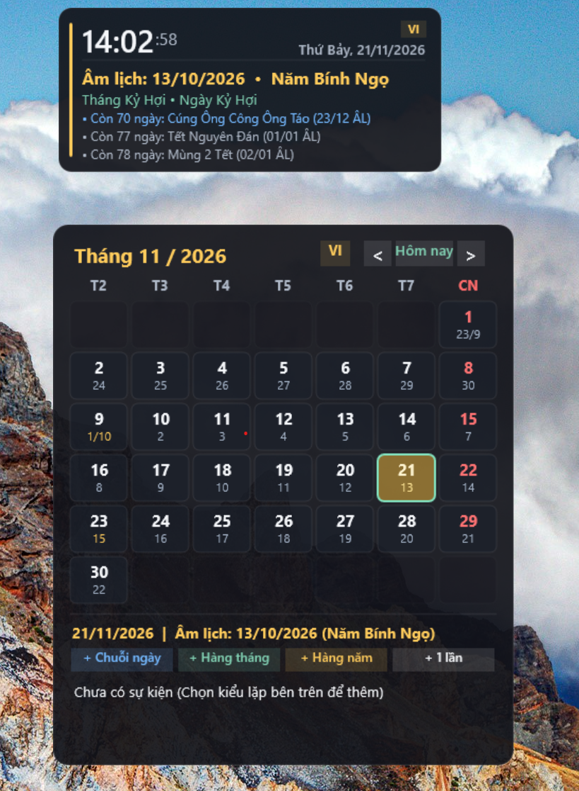

# VietLunarSuite for Rainmeter

🌐 **Language / Ngôn ngữ:** [English](#english) | [Tiếng Việt](#tiếng-việt)

---

<a name="english"></a>
## 🇬🇧 English

A sleek, bilingual (**Vietnamese / English**) Rainmeter desktop suite featuring an astronomical **Vietnamese Lunar Calendar (UTC+7)**, **Can Chi (Sexagenary Cycle)**, interactive monthly Solar/Lunar grid, and customizable Lunar event reminders & countdowns.



### ✨ Features

* **Accurate Astronomical Engine:** Pure Lua implementation calculating Vietnamese Lunar dates (UTC+7 / Hanoi timezone), leap months, and full **Can Chi** (Year, Month, Day).
* **Bilingual Support (`VI` / `EN`):** Instant 1-click toggle on either widget or via right-click context menu. Persists your last language choice across restarts (or auto-detects Windows OS language when set to `Lang=auto`).
* **Clock & Countdown Widget (`ClockWidget\Clock.ini`):**
  * Clean digital clock with Gregorian date, Lunar date, and Can Chi info.
  * Automatically highlights today's active events and displays countdowns for the **next 3 upcoming events** within 370 days.
  * **Mouse wheel zoom:** Scroll up/down on the clock card to dynamically scale the widget (`Scale` is saved automatically).
  * **Click anywhere** on the clock card to toggle the Monthly Calendar.
* **Interactive Monthly Calendar (`MonthCalendar\Calendar.ini`):**
  * Side-by-side Solar & Lunar dates with red indicator dots for holidays/events and gold highlights for `Mùng 1` (1st) & `Rằm` (15th).
  * **Instant Floating Tooltip:** Hover over any date cell to view full Can Chi details and scheduled events without delay.
  * **Built-in Vietnamese Holidays:** Preloaded with 10 major traditional Lunar holidays (Tết Nguyên Đán, Giỗ Tổ Hùng Vương, Phật Đản, Vu Lan, Trung Thu, Ông Công Ông Táo...).
  * **Custom Lunar Event Manager:** Add and delete personal reminders directly from the calendar UI with 4 recurrence modes:
    * `+ Date Range`: Daily reminder across a Lunar date span (e.g., 10-day vegetarian fasting).
    * `+ Monthly`: Repeats on the same Lunar day every month (e.g., 1st or 15th).
    * `+ Yearly`: Repeats annually on the exact Lunar day/month (e.g., family anniversaries, Lunar birthdays).
    * `+ Once`: One-time reminder on a specific Lunar date.

### 📦 Installation

#### Option 1: Using `.rmskin` Installer (Recommended)
1. Download the latest `VietLunarSuite_x.x.x.rmskin` file from the [**Releases**](../../releases) page.
2. Double-click the `.rmskin` file and click **Install**.

#### Option 2: Manual Installation
1. Clone this repository or download it as a ZIP archive:
   ```bash
   git clone https://github.com/khanhdtn/vietlunar-rainmeter.git
   ```
2. Copy the **`VietLunarSuite`** folder into your Rainmeter Skins directory (typically `C:\Users\<YourName>\Documents\Rainmeter\Skins\`).
3. Open **Rainmeter Manage**, click **Refresh all**, and load `VietLunarSuite\ClockWidget\Clock.ini`.

### ⚙️ Customization & Event Format

* **Theme & Scale:** Edit `VietLunarSuite\@Resources\Variables.inc` to customize colors (`BgColor`, `AccentGold`, `AccentSubtle`...), font (`FontMain`), default `Scale`, or `Lang` (`vi`, `en`, or `auto`).
* **Manual Event Editing:** Custom events are stored in `VietLunarSuite\@Resources\LunarEvents.inc` using the following syntax:
  ```ini
  CustomEvCount=3
  CustomEv1=YEAR|15/08|Mid-Autumn Family Dinner
  CustomEv2=MONTH|01|Vegetarian Day
  CustomEv3=RANGE|01/01/2026-10/01/2026|New Year Fasting
  ```
  *(Supported prefixes: `YEAR|DD/MM|Title`, `ONCE|DD/MM/YYYY|Title`, `MONTH|DD|Title`, `RANGE|DD/MM/YYYY-DD/MM/YYYY|Title`)*

### 📋 Requirements

* Windows 10 / 11
* [Rainmeter](https://www.rainmeter.net/) **4.5** or newer


## 🤝 Contributing 

Contributions are welcome! Please fork the repository, create a feature branch from `develop`, and submit a **Pull Request** targeting the `develop` branch.
*(Note: Keep `.lua` and `.ini` files encoded in **UTF-16 LE** so Rainmeter renders Vietnamese characters properly.)*

---

<a name="tiếng-việt"></a>
## 🇻🇳 Tiếng Việt

**VietLunarSuite** là bộ widget Lịch Âm Dương Việt Nam dành cho **Rainmeter**, tích hợp thuật toán tính Âm lịch chuẩn múi giờ **UTC+7**, xem **Can Chi** (Năm, Tháng, Ngày), lịch tháng trực quan và hệ thống nhắc nhở sự kiện Âm lịch tự động đếm ngược.


### ✨ Tính năng nổi bật

* **Thuật toán Thiên văn chính xác:** Viết thuần bằng Lua, tính toán ngày Âm lịch Việt Nam (múi giờ UTC+7 / Hà Nội), tháng nhuận và đầy đủ **Can Chi** (Năm, Tháng, Ngày).
* **Hỗ trợ Song ngữ (`VI` / `EN`):** Chuyển đổi nhanh chỉ với 1 cú bấm nút ngay trên góc widget hoặc qua menu chuột phải. Tự động lưu lựa chọn ngôn ngữ cuối cùng (hoặc tự nhận diện ngôn ngữ Windows khi đặt `Lang=auto`).
* **Widget Đồng hồ & Đếm ngược (`ClockWidget\Clock.ini`):**
  * Hiển thị đồng hồ số, ngày Dương lịch, ngày Âm lịch và Can Chi gọn gàng.
  * Tự động làm nổi bật sự kiện diễn ra trong ngày và đếm ngược **3 sự kiện sắp tới gần nhất** trong vòng 370 ngày.
  * **Cuộn chuột phóng to / thu nhỏ:** Lăn con lăn chuột trên thẻ đồng hồ để thay đổi kích thước (`Scale` tự động được lưu lại).
  * **Bấm vào bất kỳ đâu** trên thẻ đồng hồ để mở hoặc đóng nhanh Lịch Tháng.
* **Lịch Tháng Âm Dương Tương tác (`MonthCalendar\Calendar.ini`):**
  * Hiển thị song song ngày Dương & Âm lịch, chấm đỏ báo hiệu ngày lễ/sự kiện và tô vàng các ngày `Mùng 1` & `Ngày Rằm` (15).
  * **Tooltip nổi tức thì:** Rê chuột vào từng ô ngày để xem chi tiết Can Chi và danh sách sự kiện mà không có độ trễ.
  * **Tích hợp sẵn ngày lễ Việt Nam:** Sẵn sàng 10 ngày lễ Âm lịch truyền thống (Tết Nguyên Đán, Giỗ Tổ Hùng Vương, Lễ Phật Đản, Lễ Vu Lan, Tết Trung Thu, Ông Công Ông Táo...).
  * **Quản lý Sự kiện Âm lịch cá nhân:** Thêm và xóa lời nhắc trực tiếp trên giao diện lịch với 4 chế độ lặp:
    * `+ Chuỗi ngày`: Nhắc hàng ngày trong một khoảng thời gian Âm lịch (VD: ăn chay 10 ngày).
    * `+ Hàng tháng`: Lặp lại vào đúng ngày Âm lịch đó mỗi tháng (VD: Mùng 1, ngày Rằm).
    * `+ Hàng năm`: Lặp lại hàng năm vào đúng ngày/tháng Âm lịch (VD: ngày giỗ, sinh nhật Âm lịch).
    * `+ 1 lần`: Nhắc duy nhất một lần vào ngày Âm lịch đã chọn.

### 📦 Cài đặt

#### Cách 1: Dùng bộ cài `.rmskin` (Khuyên dùng)
1. Tải file `VietLunarSuite_x.x.x.rmskin` mới nhất tại trang [**Releases**](../../releases).
2. Nhấp đúp vào file `.rmskin` và bấm **Install**.

#### Cách 2: Cài đặt thủ công
1. Clone repository này hoặc tải dưới dạng file ZIP:
   ```bash
   git clone https://github.com/khanhdtn/vietlunar-rainmeter.git
   ```
2. Chép thư mục **`VietLunarSuite`** vào thư mục Skins của Rainmeter (thường là `C:\Users\<TenCuaBan>\Documents\Rainmeter\Skins\`).
3. Mở **Rainmeter Manage**, bấm **Refresh all**, sau đó nạp skin `VietLunarSuite\ClockWidget\Clock.ini`.

### ⚙️ Tùy chỉnh & Định dạng Sự kiện

* **Giao diện & Tỷ lệ hiển thị:** Chỉnh sửa file `VietLunarSuite\@Resources\Variables.inc` để đổi màu sắc (`BgColor`, `AccentGold`, `AccentSubtle`...), font chữ (`FontMain`), tỷ lệ mặc định (`Scale`) hoặc ngôn ngữ (`Lang=vi`, `en`, hoặc `auto`).
* **Chỉnh sửa sự kiện thủ công:** Các sự kiện cá nhân được lưu trong `VietLunarSuite\@Resources\LunarEvents.inc` theo cú pháp:
  ```ini
  CustomEvCount=3
  CustomEv1=YEAR|15/08|Sum họp gia đình Trung Thu
  CustomEv2=MONTH|01|Ăn chay Mùng 1
  CustomEv3=RANGE|01/01/2026-10/01/2026|Ăn chay đầu năm
  ```
  *(Các tiền tố hỗ trợ: `YEAR|DD/MM|Tiêu đề`, `ONCE|DD/MM/YYYY|Tiêu đề`, `MONTH|DD|Tiêu đề`, `RANGE|DD/MM/YYYY-DD/MM/YYYY|Tiêu đề`)*

### 📋 Yêu cầu hệ thống

* Windows 10 / 11
* [Rainmeter](https://www.rainmeter.net/) phiên bản **4.5** trở lên

### 🤝 Đóng góp

  Mọi đóng góp đều được hoan nghênh! Vui lòng **Fork** repository này, tạo nhánh tính năng mới từ nhánh `develop` và gửi **Pull Request** trỏ vào nhánh `develop` (nhánh `master` chỉ dành cho các bản phát hành ổn định).
  *(Lưu ý: Vui lòng giữ nguyên bảng mã **UTF-16 LE** cho các file `.lua`, `.ini` và `.inc` để Rainmeter hiển thị đúng tiếng Việt có dấu.)*

---

### 📄 License

Distributed under the MIT License. See [`LICENSE`](LICENSE) for more information.
